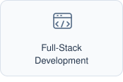
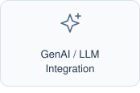
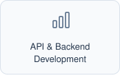
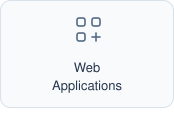
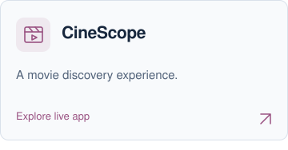
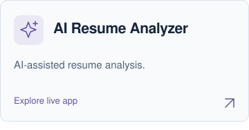
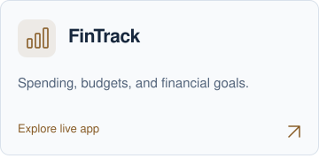
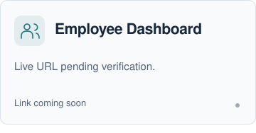
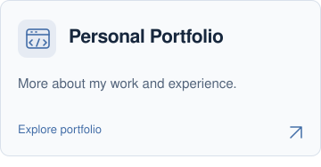
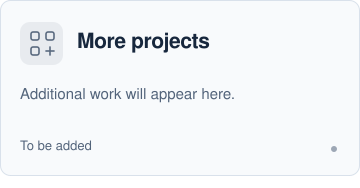

  

## Hi, I'm Vikas Mishra 👋

**Senior Software Engineer · Full-Stack Developer · GenAI / LLM Integration**

I build web applications with Python, React, and TypeScript, and integrate GenAI and LLM capabilities into useful product experiences.

  <picture>
    <source media="(prefers-color-scheme: dark)" srcset="./assets/focus-full-stack-dark.svg" />
    <source media="(prefers-color-scheme: light)" srcset="./assets/focus-full-stack-light.svg" />
    
  </picture>
  <picture>
    <source media="(prefers-color-scheme: dark)" srcset="./assets/focus-genai-dark.svg" />
    <source media="(prefers-color-scheme: light)" srcset="./assets/focus-genai-light.svg" />
    
  </picture>
  <picture>
    <source media="(prefers-color-scheme: dark)" srcset="./assets/focus-backend-dark.svg" />
    <source media="(prefers-color-scheme: light)" srcset="./assets/focus-backend-light.svg" />
    
  </picture>
  <picture>
    <source media="(prefers-color-scheme: dark)" srcset="./assets/focus-applications-dark.svg" />
    <source media="(prefers-color-scheme: light)" srcset="./assets/focus-applications-light.svg" />
    
  </picture>

 

### Featured projects

Selected public applications and upcoming work. Linked cards open the deployed application.

  <a href="https://movie-trail-ui.vercel.app/">
  <picture>
    <source media="(prefers-color-scheme: dark)" srcset="./assets/cinescope-dark.svg" />
    <source media="(prefers-color-scheme: light)" srcset="./assets/cinescope-light.svg" />
    
  </picture>
  </a>
  <a href="https://resume-cover-ui.vercel.app/">
  <picture>
    <source media="(prefers-color-scheme: dark)" srcset="./assets/resume-analyzer-dark.svg" />
    <source media="(prefers-color-scheme: light)" srcset="./assets/resume-analyzer-light.svg" />
    
  </picture>
  </a>
  <picture>
    <source media="(prefers-color-scheme: dark)" srcset="./assets/fintrack-dark.svg" />
    <source media="(prefers-color-scheme: light)" srcset="./assets/fintrack-light.svg" />
    
  </picture>
  <picture>
    <source media="(prefers-color-scheme: dark)" srcset="./assets/employee-dashboard-dark.svg" />
    <source media="(prefers-color-scheme: light)" srcset="./assets/employee-dashboard-light.svg" />
    
  </picture>
  <a href="https://vikas-mishra.vercel.app/">
  <picture>
    <source media="(prefers-color-scheme: dark)" srcset="./assets/portfolio-dark.svg" />
    <source media="(prefers-color-scheme: light)" srcset="./assets/portfolio-light.svg" />
    
  </picture>
  </a>
  <picture>
    <source media="(prefers-color-scheme: dark)" srcset="./assets/more-projects-dark.svg" />
    <source media="(prefers-color-scheme: light)" srcset="./assets/more-projects-light.svg" />
    
  </picture>

<!-- Maintainer note: FinTrack, Employee Dashboard, and More projects are intentionally
unlinked placeholders. Add only verified public deployment URLs. Project source
repositories are private; do not add source-code links, repository statistics,
or internal implementation details. -->

 

### Core technologies

**Backend** &nbsp; Python · FastAPI · Django · Node.js 
**Frontend** &nbsp; React · TypeScript 
**Data & AI** &nbsp; PostgreSQL · MongoDB · GenAI / LLM integrations

 

---

[Explore my portfolio](https://vikas-mishra.vercel.app/) &nbsp;·&nbsp; [Connect on LinkedIn](https://www.linkedin.com/in/vikasmishra07/)
